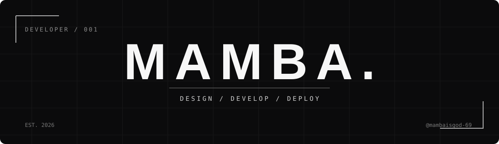
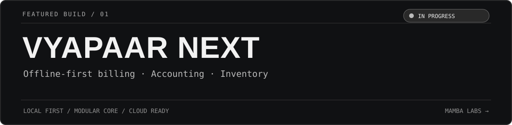

<div align="center">



<br/>

**THINK. DESIGN. SHIP. ITERATE.**

<sub>Independent Developer · Software Engineering · AI & Automation</sub>

<br/><br/>


</div>

<br/>

---

### `01 / IDENTITY`

```bash
mamba@github:~$ whoami
> Developer building thoughtful software for real-world problems.

mamba@github:~$ cat focus.txt
> Offline-first systems · Business tools · AI experiments · Automation

mamba@github:~$ echo $MOTTO
> Less noise. More building.
```

<br/>

### `02 / CURRENTLY BUILDING`

<div align="center">



</div>

**VYAPAAR NEXT** — An offline-first billing and business management system, designed around local data, accounting, inventory and future-ready sync boundaries.

`LOCAL FIRST` · `MODULAR CORE` · `CLOUD READY`

**Status:** `IN PROGRESS`

<br/>

### `03 / PROJECT INDEX`

| BUILD | PURPOSE | STAGE |
| :--- | :--- | :--- |
| **Vyapaar Next** | Offline-first billing, accounting & inventory | `IN PROGRESS` |
| **JARVIS AI** | Desktop and web AI assistant | `IN PROGRESS` |
| **Photo Vault** | Modern photo management | `IN PROGRESS` |
| **Attendance OS** | Employee attendance & workforce management | `COMPLETED` |

<sub>Projects listed reflect personal work. Public source, screenshots and demos will be linked when ready; some implementation details may remain private.</sub>

<br/>

### `04 / TECH & TOOLS`

<div align="center">


</div>

<br/>

### `05 / GITHUB ACTIVITY`

<div align="center">

#### REAL CODE. REAL PROGRESS.

*Every commit is another step forward.*

<a href="https://github.com/mambaisgod-69">

</a>

<br/><br/>

<sub>BUILDING CONSISTENTLY · ONE COMMIT AT A TIME</sub>

</div>

<br/>

---

<div align="center">


<br/>

<sub>© 2026 MAMBA · <a href="https://github.com/mambaisgod-69">@mambaisgod-69</a></sub>

</div>
